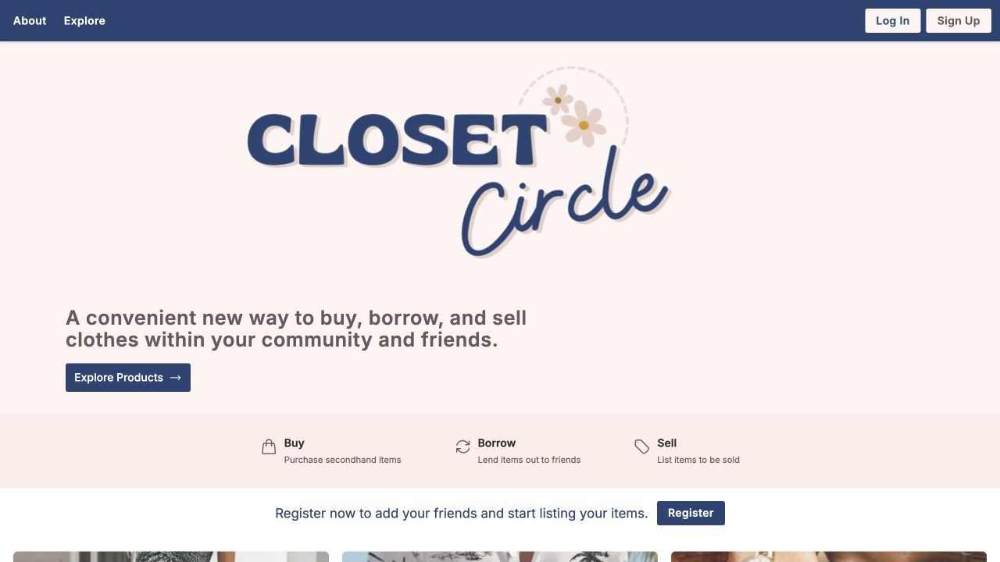

# Closet Circle

Closet Circle is a full-stack peer-to-peer clothing marketplace designed to make borrowing, exchanging, and discovering clothing more sustainable.

Users can create profiles, browse and list clothing, save favorites, manage a shopping cart, complete marketplace transactions, and view buyer and seller history.

## Product Preview

[](https://closet-circle-self.vercel.app)

*Open the [live UI demo](https://closet-circle-self.vercel.app) to explore the marketplace.*

## Project Links

- **Live UI Demo:** [closet-circle-self.vercel.app](https://closet-circle-self.vercel.app)
- **Interactive Figma Prototype:** [View the Closet Circle prototype](https://www.figma.com/proto/k5AJqFEcWgS2aVGf8On20e/Closet-Circle?node-id=37-9388&starting-point-node-id=35%3A2594&t=XDBsDJr5WX6pSzP0-1)

> **Demo note:** The Vercel deployment is intended as a frontend/UI demonstration. The original application uses a local Express + SQLite backend, so some data-mutating features in the hosted demo, such as cart, favorites, and transaction workflows, may be limited.

## Tech Stack

### Frontend
- Next.js
- React
- TypeScript
- Tailwind CSS
- Auth0

### Backend
- Node.js
- Express.js
- SQLite
- REST APIs

## Key Features

- Authenticated user accounts and profiles
- Seller listing drafts, previews, publishing, editing, archiving, and deletion
- Validated clothing image uploads with multi-image previews
- Clothing listings and product discovery
- Trending and categorized marketplace listings
- Favorites and wishlist management
- Buyer-owned shopping carts with purchase and rental intent
- Atomic checkout with availability validation and order price snapshots
- Date-based rental requests with seller approval, conflict prevention, cancellation, and completion
- Buyer order history
- Seller transaction history
- Profile management

## Architecture

Closet Circle follows a client-server architecture:

- The **Next.js frontend** provides the marketplace UI and authentication flow.
- The **Node.js/Express backend** exposes REST API endpoints for users, listings, profiles, carts, transactions, and marketplace data.
- **SQLite** stores users, listing states, categories, transactions, favorites, and related application data.
- Uploaded listing images are stored alongside the database on the backend's persistent volume.
- **Auth0** provides user authentication.

## My Contributions

Closet Circle originated as a collaborative team project and has since evolved into an independently maintained and expanded marketplace application.

My contributions included:

- Developing features across buyer and seller marketplace workflows, including order history and seller transaction history.
- Contributing to user profile, marketplace, and transaction-related functionality across the full-stack application.
- Integrating frontend features with backend REST APIs and SQLite-backed application data.
- Debugging and refining application behavior, user flows, and overall product experience.
- Independently extending the original application with production-oriented deployment, authentication and authorization, listing lifecycle management, image uploads, buyer-owned checkout, and date-based rental workflows.

## Database Design

The application uses a relational SQLite database to model users, listings, transactions, categories, favorites, and other marketplace data.


## Running Locally

### Prerequisites

Make sure the following are installed:

- Node.js 22.13 or later
- npm

### 1. Clone the Repository

```bash
git clone https://github.com/SanjanaNagwekar/closet-circle.git
cd closet-circle
```

### 2. Configure Auth0

Create a local environment file for the Next.js client:

```bash
cp client/.env.example client/.env.local
```

Fill in the Auth0 values in `client/.env.local`:

```text
AUTH0_DOMAIN=your-tenant.us.auth0.com
AUTH0_CLIENT_ID=
AUTH0_CLIENT_SECRET=
AUTH0_SECRET=
AUTH0_AUDIENCE=https://api.closet-circle
AUTH0_SCOPE=openid profile email offline_access
APP_BASE_URL=http://localhost:3000
API_BASE_URL=http://127.0.0.1:8800
```

Generate a fresh session secret with:

```bash
openssl rand -hex 32
```

Use that value for `AUTH0_SECRET`. Do not commit `.env.local` or any real credentials.

For the local Auth0 application, configure:

```text
Allowed Callback URL: http://localhost:3000/api/auth/callback
Allowed Logout URL:   http://localhost:3000
```

Create an Auth0 API with `https://api.closet-circle` as its identifier. The value only needs to be a stable identifier; it does not need to be a public URL. Add a Post Login Action to place the user's email in the API access token:

```javascript
exports.onExecutePostLogin = async (event, api) => {
  api.accessToken.setCustomClaim(
    'https://closet-circle.app/email',
    event.user.email,
  );
};
```

Add the Action to the Login flow, then configure the Express API:

```bash
cp server/.env.example server/.env
```

The client and server must use the same `AUTH0_AUDIENCE`. The server validates the token issuer, audience, and signature and reads the current user's email from `AUTH0_EMAIL_CLAIM`.

The project uses Auth0's Next.js v4 middleware while preserving the existing `/api/auth/*` login, logout, and callback URLs. Access tokens stay on the Next.js server and are attached to API requests by the `/backend-api/*` route handler rather than being exposed to browser code.

`API_BASE_URL` is read by the Next.js server. Browser requests use the same-origin `/backend-api/*` proxy, so client components do not need deployment-specific API URLs.

### 3. Install and Start the Backend

In one terminal:

```bash
cd server
npm ci
npm run db:setup
npm start
```

The backend API runs at:

```text
http://localhost:8800
```

For local development with automatic restarts, use:

```bash
npm run dev
```

The backend also supports optional environment overrides:

```bash
DATABASE_PATH=./data/closet-circle.db \
UPLOADS_PATH=./data/uploads \
CLIENT_ORIGINS=http://localhost:3000 \
AUTH0_DOMAIN=your-tenant.us.auth0.com \
AUTH0_AUDIENCE=https://api.closet-circle \
PORT=8800 \
HOST=127.0.0.1 \
npm start
```

For a deployed API, place `DATABASE_PATH` and `UPLOADS_PATH` on persistent storage and run a single API instance. The database uses WAL mode and a write timeout so reads can continue during normal writes. Multiple allowed origins can be supplied as a comma-separated `CLIENT_ORIGINS` value.

Database commands:

```bash
npm run db:migrate  # apply pending schema migrations
npm run db:seed     # add demo data when the database is empty
npm run db:setup    # migrate and seed an empty database
npm run db:reset    # rebuild the local database from scratch
```

The API exposes `/health` for process health and `/ready` for database and authentication readiness.

### Container deployment

The backend includes a Dockerfile for a single-instance deployment with persistent storage mounted at `/data`:

```bash
cd server
docker build -t closet-circle-api .
docker run --rm -p 8800:8800 \
  -e CLIENT_ORIGINS=http://localhost:3000 \
  -e AUTH0_DOMAIN=your-tenant.us.auth0.com \
  -e AUTH0_AUDIENCE=https://api.closet-circle \
  -v closet-circle-data:/data \
  closet-circle-api
```

For a hosted deployment, set `CLIENT_ORIGINS` to the frontend origin and attach persistent storage at `/data`.

### 4. Install and Start the Frontend

In a separate terminal:

```bash
cd client
npm ci
npm run dev
```

The frontend runs at:

```text
http://localhost:3000
```

## Verification

### Backend tests

From the `server` directory:

```bash
npm test
```

The tests verify server startup and health, public marketplace visibility, authentication and ownership boundaries, listing drafts and publishing, image validation, listing updates, cart isolation, checkout behavior, rental approvals and date conflicts, archiving, deletion, and removal of legacy mutation endpoints.

### Frontend production build

From the `client` directory:

```bash
npm run build
```

Running the production build is the quickest way to catch TypeScript, Next.js, authentication-integration, or bundling issues before deployment.

## Project Documentation

Additional design and architecture documentation is available in the [`documentation`](documentation/) directory, including:

- [Product case study](documentation/product_case_study.md)
- Original project presentation
- Block architecture
- Layer architecture
- Class diagram
- Sequence diagrams
- Feature documentation

Database schema files and the ER diagram are available in [`server/databases`](server/databases/).

## Project Evolution

The application began as a collaborative team project. The current version is independently maintained and extends that foundation with redesigned marketplace workflows, stronger security boundaries, persistent uploads, deployment support, automated verification, and complete buyer, seller, and rental lifecycles.
