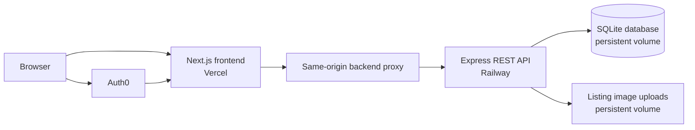

# Current Architecture

Closet Circle is a deployed client-server marketplace. The browser talks only to the Next.js application; authenticated API requests pass through a same-origin proxy before reaching the Express API.

## Responsibilities

### Next.js frontend

- Renders public discovery, listing details, cart, account, and seller workflows.
- Manages the Auth0 browser session.
- Keeps access tokens server-side and forwards authenticated requests through `/backend-api/*`.
- Uses one same-origin API path in local and hosted environments.

### Express API

- Validates Auth0 access tokens and derives the current user from verified claims.
- Enforces listing, cart, favorite, order-history, seller-history, and rental ownership.
- Revalidates price and availability during checkout.
- Coordinates purchase and rental state changes with database transactions.
- Serves uploaded listing images and health/readiness endpoints.

### SQLite and persistent uploads

- Stores users, listings, categories, favorites, carts, transactions, and rental requests.
- Runs in WAL mode with a write timeout on a single Railway API instance.
- Uses migrations and seed scripts so local and hosted schemas are reproducible.
- Stores uploaded files on the same persistent Railway volume as the database.

## Deployment boundary

Vercel hosts the Next.js frontend and Railway hosts one containerized Express instance. This is intentionally sized for the project's current portfolio and demonstration usage. If sustained concurrent usage grows, the next infrastructure step is managed object storage plus a managed relational database that supports multiple API instances.

## Security boundary

The browser may provide resource identifiers, but it does not provide trusted identity. Protected API routes use the verified token identity to determine ownership. This prevents one user from reading or mutating another user's cart, favorites, listings, rental requests, or transaction history by changing an email or ID in a request.
