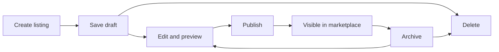
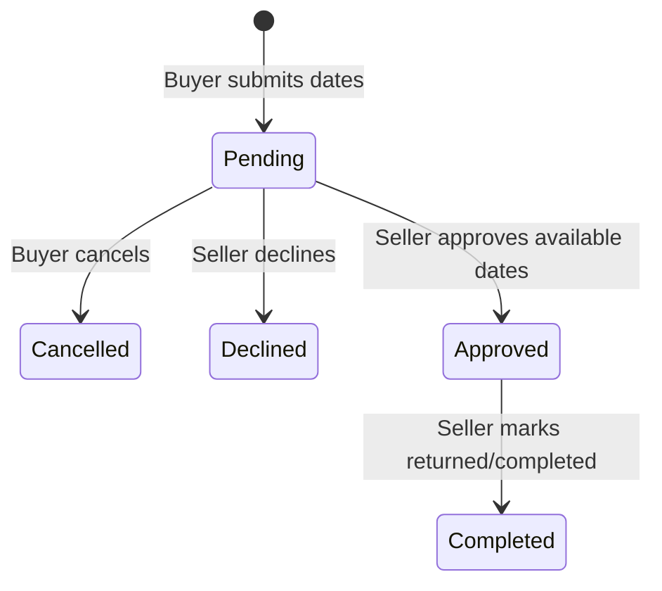

# Current Features and Workflows

This document describes the behavior available in the hosted Closet Circle application today. Checkout is a simulated marketplace transaction and does not collect payment.

## Public discovery

- Browse seeded and user-created published listings.
- Search listing titles and descriptions.
- Filter by audience, item type, color, size, and condition.
- Open a quick view for details without leaving the results page.
- View sale and rental availability before starting an authenticated action.

## Accounts and profiles

- Sign in through Auth0.
- Create and update a marketplace profile.
- View private buyer, seller, and rental activity only for the signed-in account.
- Follow or unfollow other marketplace profiles.

## Seller workflow

- Create sale, rental, or dual-purpose listings.
- Upload up to five validated JPEG, PNG, or WebP images.
- Save incomplete work as a draft.
- Preview and publish complete listings.
- Edit, archive, republish, or delete owned listings.
- Review sales and completed rental activity in seller history.

## Buyer workflow

- Save and remove favorites.
- Add a purchase or rental intent to a buyer-owned cart.
- Select rental dates before submitting a rental request.
- Remove cart items or complete the simulated checkout.
- View purchase and rental activity in account history.

## Purchase lifecycle

Checkout revalidates each listing's publication state, availability, and current price. A successful purchase records the price snapshot, archives the sold listing, declines conflicting pending rental requests, and opens a new pending cart for the buyer.

## Rental lifecycle

- Buyers can cancel only while a request is pending.
- Sellers can approve or decline pending requests.
- Approved dates block conflicting approvals and purchases.
- Sellers complete approved rentals after the item is returned.
- Statuses remain visible to both buyer and seller.

## Reliability and verification

- Backend tests cover authentication, ownership, listing lifecycle, uploads, cart isolation, checkout, and rental conflicts.
- The frontend production build performs TypeScript and Next.js validation.
- CI runs tests, builds, and runtime dependency audits.
- `/health` checks the API process; `/ready` checks database and authentication configuration.
