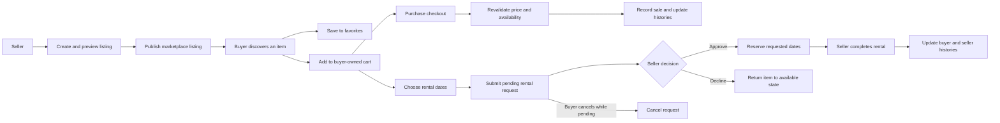

# Closet Circle Product Case Study

## Product problem

Clothing resale products often optimize for a single purchase and stop at discovery. Closet Circle explores a broader peer-to-peer marketplace where a seller can offer an item for sale, short-term rental, or both, while buyers can save items, compare options, and manage transactions in one place.

The core product challenge was making the marketplace understandable and trustworthy for both sides:

- Buyers need clear availability, rental dates, pricing, and request status.
- Sellers need control over listing quality, publication, availability, and rental approvals.
- Both sides need actions to be isolated to the authenticated account and protected from conflicting transactions.

## Approach

The product was organized around complete buyer and seller journeys rather than isolated screens.

For sellers, that meant supporting the progression from draft to preview, publication, editing, archiving, and deletion. Image validation and listing requirements prevent incomplete inventory from appearing in the marketplace.

For buyers, that meant connecting discovery, favorites, a buyer-owned cart, availability checks, checkout, and history. Rentals extend that journey with date selection and a dashboard shared across buyer and seller perspectives.

The original collaborative project provided the marketplace foundation. The current version independently extends it with production-oriented authentication, ownership boundaries, deployment configuration, and complete listing, checkout, and rental lifecycles.

## Marketplace workflow

The two paths share discovery and cart behavior but separate at checkout. Purchases complete atomically after availability is revalidated, while rentals remain pending until the seller makes an explicit decision.

## Key product decisions and tradeoffs

### Seller approval before rental confirmation

A rental is submitted as a request rather than treated as an immediate purchase. This gives sellers control over availability while giving buyers a visible status. Pending requests may overlap, but only one request can be approved for the same dates.

### Pending-only buyer cancellation

Buyers may cancel while a request is pending. Once a seller approves it, the commitment cannot be cancelled through the current workflow. This keeps the first version's state model predictable without implying a cancellation or refund policy that the product does not yet support.

### Transaction consistency over optimistic completion

Checkout revalidates listing state and price instead of trusting what was previously placed in the cart. Purchases and rental requests are written atomically. An item committed to an approved rental cannot be purchased, and selling an item declines any remaining pending rental requests.

### SQLite for the current product stage

SQLite keeps local development and demonstration setup simple while supporting the current expected usage. WAL mode, a write timeout, transactions, migrations, and a single-instance deployment model improve reliability without introducing infrastructure that the project does not yet need. A managed relational database would be the next step if concurrent production usage grows.

### Authentication at the system boundary

Auth0 establishes identity, but authorization is enforced by the Express API. The API derives ownership from the verified access token rather than accepting an email address supplied by the browser. Access tokens remain on the Next.js server and are forwarded through a same-origin backend proxy.

### Payment processing remains out of scope

The application records purchases and rental requests but does not collect payment. Rental totals are explicitly labeled as estimates. This keeps the project focused on marketplace decision-making and lifecycle integrity without presenting a simulated checkout as a real financial transaction.

## What works today

- Authenticated profiles with protected buyer and seller data.
- Searchable marketplace inventory with favorites and listing availability.
- Seller drafts, image previews, publishing, editing, archiving, and deletion.
- Buyer-owned carts with purchase and rental intent.
- Atomic checkout, price snapshots, and buyer/seller history.
- Date-based rental requests, approval, conflict detection, cancellation, and completion.
- Persistent SQLite and upload paths for a single-instance container deployment.
- Automated backend tests, production builds, dependency audits, and continuous integration.

## Evidence

The repository includes automated coverage for authentication boundaries, listing ownership, image validation, marketplace visibility, cart isolation, checkout, rental conflicts, state transitions, and legacy endpoint removal. The production frontend build includes TypeScript and framework validation, and runtime dependency audits run in continuous integration.

This evidence demonstrates functional and technical completeness. It is not a substitute for user research, and no usability metrics are claimed without observed testing.

## Validation plan

The next product-learning step is a small moderated usability study with three to five participants using two high-value tasks:

1. List an item for rental and publish it.
2. Find an item, choose rental dates, submit a request, and identify its status.

For each task, record completion, time to completion, points of hesitation, errors, and participant comments. Prioritize one repeated usability problem, implement the smallest useful correction, and compare the same task before and after the change.

## Next product opportunities

- Define cancellation, return, and dispute policies before allowing post-approval cancellation.
- Add seller-facing calendar availability controls for repeat rentals.
- Introduce payment authorization only after transaction and policy requirements are defined.
- Move to managed object storage and a managed relational database when production scale requires multiple API instances.
- Add notifications for rental decisions and upcoming return dates.
